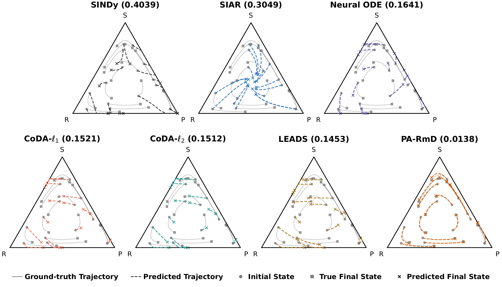

# PA-RmD

Source code for the NeurIPS 2026 paper Payoff-Aware Prediction of Population Game Dynamics.

We study how to predict population trajectories under new payoff functions using observations from previous payoff settings. Our method, PA-RmD, builds on Riemannian game dynamics to separate payoff-dependent incentives from a shared population response structure learned from data.

[](assets/cyclic_rollout_replicator_full.pdf)

*Rollout predictions for cyclic replicator dynamics.*

## Installation

```bash
pip install -r requirements.txt
```

## Quick Start

### Run experiments

Run PA-RmD on the synthetic or YouTube experiments:

```bash
bash scripts/pa_rmd.bash synthetic
bash scripts/pa_rmd.bash youtube
```

More bash files are in `scripts/`.

Add `--dry-run` to a script to inspect its settings without running it.

Results are saved in `outputs/<dataset>/`. Use `--run-tag NAME` for another run.

### Plot results

After running all method scripts, generate the result tables and figures:

```bash
python -m pa_rmd.plots --run outputs/synthetic-payoff-family --summary
python -m pa_rmd.plots --run outputs/youtube-multicountry --summary
```

The results are shown in `tables/` & `figures/`.


## License

This project is licensed under the [MIT License](LICENSE).
